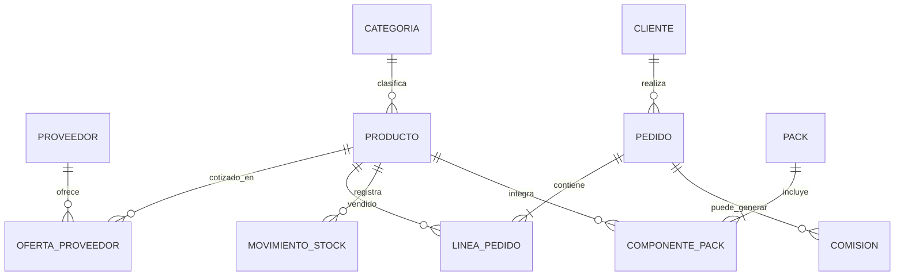

# Modelo conceptual de datos

Este diagrama describe relaciones de negocio; **no** prescribe crear tablas duplicadas de Odoo.

## Campos y reglas iniciales
- **Producto:** identificador, SKU, nombre, categoría, unidad de medida, precio de venta, estado.
- **Proveedor:** identificador, razón social, contacto, condiciones comerciales.
- **Oferta de proveedor:** proveedor, producto, costo, unidad, vigencia, disponibilidad (permite varios proveedores por producto).
- **Cliente:** identificador, nombre, contacto y direcciones.
- **Pedido/línea:** cliente, estado, fecha, producto o pack, cantidad, precio unitario e impuestos según configuración.
- **Movimiento de stock:** producto, ubicación, cantidad, tipo, referencia y fecha.
- **Pack/componente:** nombre del pack, producto, cantidad, unidad y costo calculado.
- **Comisión:** pedido, beneficiario, regla y estado; fórmula pendiente.

## Consideraciones
Usar modelos nativos de Odoo cuando existan: contactos, productos, órdenes y movimientos de inventario. Evitar restar stock manualmente en SQL. Las unidades por kilo deben configurarse con conversiones y precisión consistentes. Definir si los packs se arman anticipadamente o al preparar pedidos.
